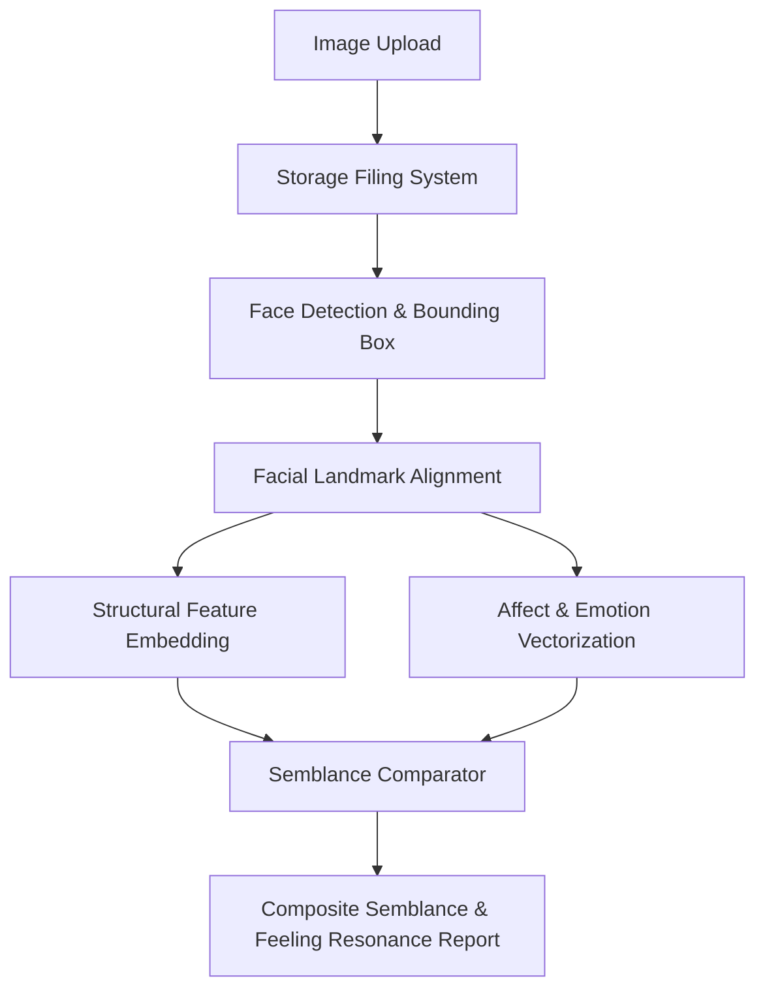

# System Architecture: Facial Recognition & Semblance Engine

## 1. Vision & Core Philosophy

Traditional facial recognition algorithms operate with a strict binary mandate: *Is Subject A identical to Subject B?* (1:1 verification or 1:N identification).

The **Semblance Engine** shifts the focus to **Resemblance and Affective State Analysis**:
1. **Geometric Semblance**: How similar are the structural proportions, key landmarks, and aesthetic contours between faces?
2. **Emotional & Feeling Semblance**: How closely aligned are the human feelings conveyed by the subjects? Does a slight smile evoke serene composure, nervous tension, or authentic delight? How do micro-expressions match across contexts?

---

## 2. Architectural Layers

### A. API Layer (`app/api/`)
- Handles HTTP requests, file uploads, parameter parsing, and serialization.
- Built with FastAPI, utilizing asynchronous request routing and automatic OpenAPI documentation.
- Routers are modularized by domain (`routes_upload.py`, `routes_semblance.py`).

### B. Core Layer (`app/core/`)
- Contains global application configuration, environment settings, and directory routing.
- Uses strongly-typed settings (`app.core.config.settings`) to ensure storage paths are computed dynamically relative to the application root.

### C. Schemas Layer (`app/schemas/`)
- Implements Pydantic v2 models that serve as immutable data contracts between layers.
- Defines typed responses for uploads, bounding coordinates, affective metrics (valence, arousal, discrete emotions), and comparative resemblance vectors.

### D. Services Layer (`app/services/`)
- **`file_service.py`**: Manages the local storage filing system. Sanitizes filenames, enforces storage quotas, generates unique UUIDv4 tokens, and performs safe filesystem operations.
- **`semblance_service.py`**: Coordinates face detection, feature extraction, emotion decomposition, and mathematical similarity computations (cosine similarity and Euclidean distance).

### E. Utilities Layer (`app/utils/`)
- Standalone stateless functions, such as image integrity checks and file pointer rewinding.

---

## 3. Mathematical Foundations of Semblance

The composite semblance between two subjects $S$ (Source) and $T$ (Target) is computed as:

$$\text{Composite Semblance} = w_{\text{geo}} \cdot \text{Sim}_{\text{structural}}(F_S, F_T) + w_{\text{aff}} \cdot \text{Sim}_{\text{emotional}}(E_S, E_T)$$

Where:
- $F_S, F_T$ are the facial geometric embedding vectors.
- $E_S, E_T$ are the emotional feeling vectors across affective dimensions:
  $$\vec{E} = [p_{\text{joy}}, p_{\text{serenity}}, p_{\text{sorrow}}, p_{\text{wonder}}, p_{\text{tension}}, p_{\text{neutral}}]$$
- $\text{Sim}_{\text{emotional}}$ computes the cosine similarity between the feeling distributions:
  $$\text{Sim}_{\text{emotional}} = \frac{\vec{E}_S \cdot \vec{E}_T}{\|\vec{E}_S\| \|\vec{E}_T\|}$$
- $w_{\text{geo}}$ and $w_{\text{aff}}$ are customizable weights reflecting whether visual likeness or emotional parity is prioritized.
